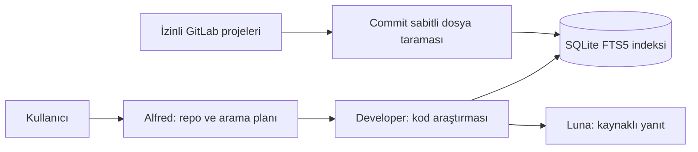

# AI Office

Alfred'in yönettiği, GitLab kod tabanlarını araştıran bir ajan ofisi. İlk sürümde **Alfred (CEO)** ve **Developer** aktiftir. Analyst & QA, Security, Architect, DevOps ve DB Agent genişletilecek rollerdir; henüz görev yürütmezler.

## Başlatma

Python 3.11+ ve GitLab `read_api` yetkili token gerekir. Repo klonlama veya şirket kodunu çalıştırma yapılmaz.

```bash
python -m venv .venv
source .venv/bin/activate
pip install -e '.[test]'
cp .env.example .env
# .env içindeki GitLab URL/token ve Luna URL/token/model alanlarını doldurun.
# repositories.yaml içine izin verilen projeleri ekleyin.
python -m office
```

Ofis: **http://127.0.0.1:8796**. Önce **İndeksle**, ardından Alfred'e sorun. API belgeleri `/api/docs` adresindedir. Bağlantı alanları dolu olması erişimin doğrulandığı anlamına gelmez; ilk indeksleme/model çağrısı gerçek erişimi sınar.

## Tek merkezden ayarlar

Tüm bağlantı URL'leri, model ve token'lar sunucudaki `.env` dosyasındadır. Şifreler arayüze/API durum yanıtına gönderilmez. `.env` ve çalışma verisi Git'e alınmaz. Dosya izinlerini yerel kullanıcıyla sınırlayın. Ayar değişikliğinden sonra sunucuyu yeniden başlatın. Token'ları sohbetlere veya `repositories.yaml` içine yazmayın.

Luna adaptörü `LUNA_BASE_URL/chat/completions` adresine Bearer token ile OpenAI uyumlu `messages`, `model`, `temperature`, `max_tokens` gönderir ve `choices[0].message.content` bekler. Örneğin base URL `https://luna.company/v1` olabilir. Luna farklı bir sözleşme kullanıyorsa yalnız `office/agents.py:Luna` adaptörünü uyarlayın. Şirket Luna uç noktası/token'ı olmadan gerçek bağlantı doğrulanmamıştır.

```yaml
repositories:
  - id: payments
    project: platform/payments-api  # GitLab yolu veya numeric project ID
    ref: main
    description: Ödeme, iade ve fatura işlemleri
    tags: [payment, refund, billing]
    depends_on: [identity]
    exclude: ["migrations/**", "internal/secrets/**"]
  - id: identity
    project: platform/identity
    ref: main
    description: Kimlik doğrulama ve yetkilendirme
    tags: [authentication, authorization, jwt]
```

GitLab alt grup yolları ve self-managed kurulumlar desteklenir. `GITLAB_URL` GitLab kök adresidir (ör. `https://gitlab.company`). İzin listesi dışında hiçbir projeye gidilmez. Numeric project ID kullanılırsa kaynak dosyası/satırı gösterilir, tarayıcı bağlantısı üretilmez.

## Akış ve indeks



LangGraph `alfred → developer → report` akışını yürütür. Alfred repo açıklamalarını, etiketleri ve README özetlerini kullanarak en fazla dört repo seçer; Türkçe sorular için İngilizce kod arama terimleri üretebilir. Developer soruyu ve en fazla üç arama sorgusunu seçilen repolarda arar. En fazla 18 kod parçasıyla cevap üretilir; dosya, satır ve commit kaynakları ayrıca döner. Her soru bağımsızdır; konuşma geçmişi modele taşınmaz. Boşta model çağrısı yoktur.

İndeksleme GitLab API üzerinden branch'i **tek bir commit SHA** ile sabitler; sayfalanan dosya ağacını ve ham dosyaları okur. 80 satırlık, 20 satır örtüşmeli parçalar; dosya/sembol/import bilgisi ve README kataloğu SQLite'a yazılır. Her repo güncellemesi tek transaction ile değiştirilir; hata halinde o reponun önceki indeksi korunur. Çoklu repo işinde daha önce tamamlanan repolar korunur. Silinmiş dosyalar sonraki indekslemede kaldırılır. Değişiklikler **manuel yeniden indeksleme** ile görünür; otomatik webhook/zamanlayıcı yoktur.

İlişki görünümü repo seviyesinde `depends_on` bildirimlerini ve dosya seviyesinde regex ile çıkarılmış sembol/import listesini verir. Bu sürüm çözülmüş çağrı grafiği veya AST analizi yapmaz. Arama **yerel lexical FTS5** aramasıdır; embedding/vektör araması yoktur. Kavramsal eşleşme, repo açıklamaları ve Luna'nın arama terimi üretimiyle desteklenir; tüm kodu eksiksiz anlama garantisi vermez. İlgili kod bulunamazsa yanıt bunu belirtir.

## Sınırlar ve veri

- Repo başına en fazla 5000 blob ve 64 MB indekslenecek metin; dosya başına en fazla 300 KB. Büyük/binary dosyalar, bilinen secret isimleri, build/vendor dizinleri ve tanımlanan exclude desenleri atlanır. Bunlar genel bir secret tespit sistemi değildir; hassas dizinleri ayrıca dışlayın.
- Kod parçaları yerel `data/index.sqlite3` dosyasına ve soruya ilişkin seçilen parçalar şirket Luna'sına gider. İndeksteki kod, repodan erişim kaldırıldıktan sonra da diskte kalır; kalıcı silme için sunucuyu durdurup `data/` klasörünü kaldırın. Aktif repo listesinden çıkarılmış projeler sorgulanamaz.
- Token ve TLS doğrulaması zorunludur; yönlendirmeler takip edilmez. Sunucu localhost içindir, kullanıcı kimlik doğrulaması içermez; internete veya paylaşımlı ağa açmayın. Host/Origin denetimi ve CSP bulunur.
- Repo içeriği talimat olarak güvenilir kabul edilmez. Modelin shell, yazma, push veya dış servis aracı yoktur. Model yanıtları yine de incelenmelidir.
- İndeks işleri tek süreçte seri çalışır; durum bellektedir, yeniden başlatınca iş listesi kaybolur. İndeks kalıcıdır. Tek Uvicorn worker kullanın.
- LangSmith varsayılan kapalıdır. Şirket kodunu dış izleme sistemine göndermek onaylıysa `.env` içindeki `LANGSMITH_*` alanlarını ve çalışma ortamını ayarlayabilirsiniz. Bu sürüm ayrıca LangSmith exporter kurmaz; LangGraph/LangChain'in standart tracing desteğini kullanır.

## API ve doğrulama

| API | İşlev |
|---|---|
| `GET /api/status` | Roller, repo indeksleri, maskelenmiş bağlantı durumu ve işler |
| `POST /api/index` | `{}` tüm repolar; `{"repository":"payments"}` tek repo; 202 iş kimliği |
| `POST /api/chat` | `{"question":"İade akışı nasıl çalışıyor?"}` → yanıt, adımlar, kaynaklar |
| `GET /api/graph` | Bildirilen repo ilişkileri ve çıkarılmış dosya/sembol/import kataloğu |

```bash
pytest
```

Testler mock GitLab/Luna ile indeks yenileme, silinen dosya temizliği, hata anında eski snapshot, commit tutarlılığı, izin listesi, kaynaklar ve yerel API güvenliğini doğrular. Gerçek şirket bağlantıları kurulum sonrasında denenmelidir.

## Referans

[selmakcby/ajan-ofisi](https://github.com/selmakcby/ajan-ofisi) ofis/CEO deneyimi için incelendi. Bu projede kaynak kodu veya görsel varlıkları kopyalanmadı; Python/Luna/GitLab uygulaması ve arayüz özgün olarak geliştirildi. Referans proje PolyForm Noncommercial lisanslıdır.
